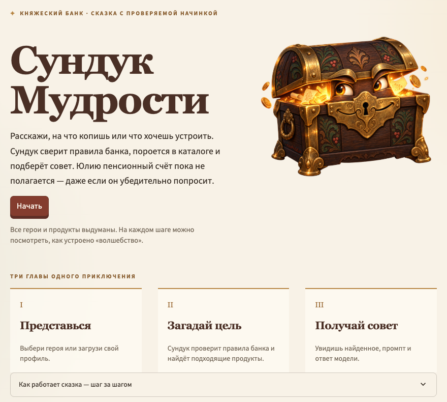

[English](README.md) · [**Русский**](README.ru.md)

# Сундук Мудрости

Сказочный советник Княжеского банка, которому можно заглянуть под крышку. Выбираешь героя, задаёшь финансовый вопрос и видишь, как RAG-пайплайн проверяет правила банка, находит подходящие выдуманные продукты и собирает ответ.

**[Открыть демо](https://fairy-financial-rag-demo.streamlit.app/)** · Все герои, продукты, условия и советы выдуманы.



Бесплатный Streamlit Cloud может усыпить приложение между визитами. Если он предложит разбудить демо, первый поиск после пробуждения займёт больше времени: загружается модель эмбеддингов.

## Попробовать за две минуты

1. Нажми **«Начать»** и возьми демо-профили.
2. Введи `3333`, чтобы войти за Илью Муромца, или `5555` — за коня Юлия. Юлию двенадцать: у фильтра по возрасту есть мнение насчёт пенсионных продуктов.
3. Спроси, например: **«Нужен заём на нового коня»**.
4. Загрузи демо-продукты и пройди фильтр, поиск, промпт и ответ.

Демо показывает работу на каждом шаге: какие продукты отсеяны и почему, каким методом шёл поиск, что хранится в Chroma, какие продукты попали в промпт и что именно было отправлено модели. «Магию» можно проверить.

## Что под крышкой

```text
герой + вопрос                       каталог выдуманных продуктов
      │                                          │
      └────────────────┬─────────────────────────┘
                       ▼
          фильтр по возрасту, доходу, гражданству
                       ▼
          поиск до пяти подходящих продуктов
                       ▼
          промпт с данными героя и найденным
                       ▼
          ответ Groq / gpt-oss-20b
          или явно помеченный шаблонный ответ
```

- **Сначала правила.** То, что герою не положено, отсекается до поиска. Те же ограничения передаются в Chroma как `where`; тесты сверяют результат с фильтром Python для всех демо-героев.
- **Поиск виден.** Основной путь — эмбеддинги `paraphrase-multilingual-MiniLM-L12-v2` и коллекция Chroma в памяти с косинусным сходством. Если часть стека недоступна, приложение пробует те же векторы в памяти, TF-IDF, затем поиск по ключевым словам.
- **Модель знает только отобранное.** В промпт попадают вопрос, профиль героя и описания найденных продуктов. Промпт можно раскрыть на экране. Нет Groq или ключа — приложение честно помечает шаблонный ответ.

В `data/` лежат **11 героев** и **32 продукта**. Можно загрузить свои JSON-файлы: приложение проверяет файл целиком до принятия. Формат и обязательные поля показаны на шагах загрузки.

## Границы демо

Это демонстрация принятия решения, а не банк и не источник реальных финансовых советов. Каталог маленький и полностью выдуманный. Chroma живёт в памяти процесса: при новом каталоге или перезапуске коллекция собирается заново. Для большого каталога понадобилось бы постоянное хранилище. Пороги сходства подобраны для демо-вопросов; на других данных их надо проверять. Модель видит короткие описания и может упустить детали.

Сундук на стартовом экране — самостоятельный сказочный персонаж. Он добавляет характер, а фильтр, поиск и промпт остаются открытыми для проверки.

## Запуск локально

Нужен Python 3.11 (`runtime.txt` закрепляет 3.11.9 для Streamlit Cloud).

```bash
python3.11 -m venv .venv
source .venv/bin/activate
pip install -r requirements-macos.txt  # macOS; на Linux — requirements.txt
streamlit run app.py
```

`requirements.txt` закрепляет Linux CPU-сборку PyTorch для Streamlit Cloud; `requirements-macos.txt` использует обычную сборку для macOS при тех же версиях зависимостей.

Для ответа модели положи ключ Groq в `.streamlit/secrets.toml` (файл игнорируется Git):

```toml
GROQ_API_KEY = "твой-ключ"
```

Без ключа фильтр и поиск работают; последний экран показывает явно помеченный шаблонный ответ.

## Тесты и устройство проекта

```bash
pip install -r requirements-dev.txt
pytest
```

Тесты проверяют JSON, правила допуска и их перевод в Chroma, запасные способы поиска, сборку промпта и сквозной сценарий Streamlit без настоящего вызова Groq.

| Путь | Что делает |
| --- | --- |
| `app.py`, `screens/` | Сказка в Streamlit и семь видимых шагов |
| `rag/` | Проверка данных, правила, поиск, база, промпт, запасной ответ |
| `data/` | Выдуманные герои и продукты банка |
| `assets/` | Иллюстрация сундука и оформление |
| `tests/` | Проверки пайплайна и приложения целиком |

## Лицензия

MIT, см. [LICENSE](LICENSE).
